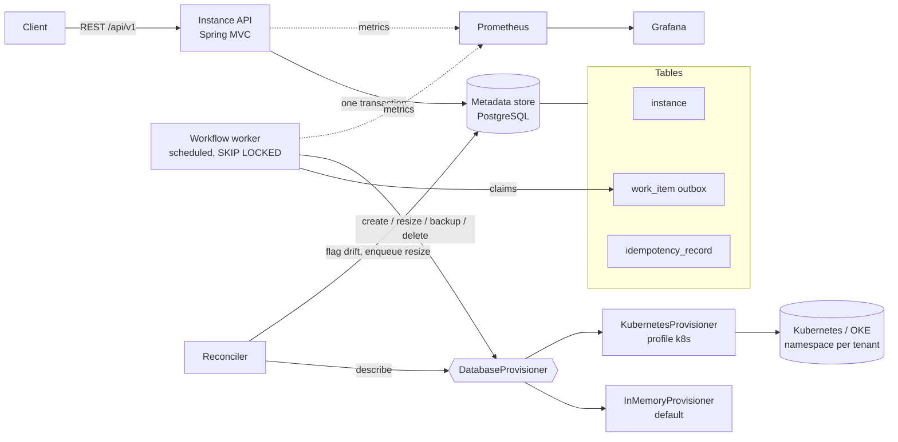

# pg-control-plane

A PostgreSQL "database as a service" control plane: a REST API that provisions and manages the lifecycle of
PostgreSQL instances for multiple tenants, the way a managed-database cloud service does.

> **Personal portfolio project.** It was built to learn and demonstrate control-plane design (Java, Spring Boot,
> PostgreSQL, Kubernetes, Terraform on OCI). It has no users and has never run in production. The Kubernetes
> adapter is tested against a mock API server only, and the Terraform has never been applied to a real tenancy.
>
> **How this was built:** AI-assisted development. Every change was reviewed by the author and is covered by
> tests that run in CI.

## What it does
- `POST /api/v1/instances` accepts a request, stores it, and returns **202 Accepted** immediately.
- A background worker provisions the database (PostgreSQL 16 in a Kubernetes StatefulSet, or an in-memory fake).
- Resize, backup and delete are asynchronous in the same way; a reconciler repairs drift.
- Multi-tenant: every call is scoped to a tenant, with per-tenant quotas.

## Architecture



### Create flow

```mermaid
sequenceDiagram
    participant C as Client
    participant A as API (InstanceService)
    participant D as Metadata DB
    participant W as Worker
    participant P as Provisioner
    C->>A: POST /instances (X-Tenant-Id, Idempotency-Key)
    A->>D: BEGIN; check key, lock tenant row, check quota
    A->>D: INSERT instance(REQUESTED), work_item(CREATE), idempotency_record
    A->>D: COMMIT
    A-->>C: 202 Accepted + Location
    loop every second
        W->>D: SELECT ... FOR UPDATE SKIP LOCKED, claim (lease)
    end
    W->>D: REQUESTED -> PROVISIONING
    W->>P: create(spec) (idempotent)
    P-->>W: endpoint
    W->>D: PROVISIONING -> AVAILABLE, work_item DONE (one transaction)
    C->>A: GET /instances/{id}
    A-->>C: state=AVAILABLE, endpoint
```

### Lifecycle

```
REQUESTED -> PROVISIONING -> AVAILABLE <-> UPDATING
                              AVAILABLE -> DELETING -> DELETED
any in-progress state -> FAILED        (also AVAILABLE -> FAILED from the reconciler, FAILED -> DELETING for cleanup)
```

## Quickstart

### Run the tests (no Docker needed)
```bash
./mvnw -B verify
```
The Testcontainers PostgreSQL test is skipped automatically when Docker is not running.

### Run locally with Docker
```bash
docker compose -f deploy/local/docker-compose.yml up --build
# API: http://localhost:8080   Swagger UI: http://localhost:8080/swagger-ui.html
# Prometheus: http://localhost:9090   Grafana: http://localhost:3000 (dashboard "PG Control Plane")
```

### Try it with curl
```bash
# Create (202 + Location). Repeating the same command returns the same instance.
curl -i -X POST localhost:8080/api/v1/instances \
  -H 'X-Tenant-Id: acme' -H 'Idempotency-Key: demo-1' -H 'Content-Type: application/json' \
  -d '{"name":"orders-db","plan":"small","storageGb":20}'

# Poll until state is AVAILABLE (the default in-memory provisioner takes about a second)
curl -s localhost:8080/api/v1/instances/<id> -H 'X-Tenant-Id: acme'

# List (paged, tenant-scoped)
curl -s 'localhost:8080/api/v1/instances?page=0&size=20' -H 'X-Tenant-Id: acme'

# Grow storage and change plan
curl -i -X PATCH localhost:8080/api/v1/instances/<id> -H 'X-Tenant-Id: acme' \
  -H 'Content-Type: application/json' -d '{"plan":"medium","storageGb":100}'

# Backup, then delete
curl -i -X POST localhost:8080/api/v1/instances/<id>/backups -H 'X-Tenant-Id: acme'
curl -i -X DELETE localhost:8080/api/v1/instances/<id> -H 'X-Tenant-Id: acme'

# Another tenant cannot see it (404)
curl -i localhost:8080/api/v1/instances/<id> -H 'X-Tenant-Id: globex'
```
Plans: `small` (1 CPU, 2 GB, up to 500 GB), `medium` (2 CPU, 8 GB, up to 2 TB), `large` (4 CPU, 16 GB, up to 8 TB).
Default quota is 5 instances per tenant. Errors are RFC 7807 `application/problem+json`.

### Real Kubernetes
Run with `SPRING_PROFILES_ACTIVE=k8s` against a cluster in your kubeconfig, or deploy `deploy/k8s/`
(Deployment, Service, and a ClusterRole so it can manage tenant namespaces). Infrastructure for OKE is in
`infra/terraform/oci` (see its README).

## Design decisions (details in `docs/ARCHITECTURE.md`)
- **Outbox + worker, not a call from the request thread.** The instance row and its `work_item` commit atomically, so
  a request is never half-recorded; provisioning takes minutes and must survive restarts.
- **`SELECT ... FOR UPDATE SKIP LOCKED` claiming with leases.** Many replicas can run workers without double work;
  a crashed worker's lease expires and another takes over. Falls back to a plain select + compare-and-set on H2.
- **Idempotency everywhere.** Client side via `Idempotency-Key` (hashed body, 409 on mismatch); provisioner side
  via get-or-create operations, because delivery is at-least-once.
- **State machine in the entity.** `transitionTo` is the only way to change state; illegal moves throw (409).
  `@Version` gives optimistic locking against concurrent writers.
- **Desired vs actual.** The DB holds desired state; the reconciler asks the provisioner what really exists.
- **Ports and adapters.** `DatabaseProvisioner` has an in-memory adapter (tests, demos, failure injection) and a Kubernetes one.
- **Tenant from a header** is a demo shortcut. A real system derives it from the authenticated token.

## Observability
Actuator at `/actuator/health` and `/actuator/prometheus`. Custom metrics: `pgcp_provisioning_duration_seconds`
(timer), `pgcp_workflow_failures_total{type,permanent}`, `pgcp_instances{state}` (gauge),
`pgcp_reconciler_drift_total{kind}`. Log lines carry `tenant=`, `instance=` and `req=` from the MDC.

## Limitations and next steps
- No authentication or authorisation; tenant header is trusted. Next: JWT with a tenant claim, OCI IAM mapping.
- Single PostgreSQL pod per instance: no HA/replication, no failover, no point-in-time recovery, no connection pooling.
- The Kubernetes backup is a `pg_dump` Job into a PVC and is not awaited; real backups go to Object Storage.
- The reconciler scans all AVAILABLE instances each pass (fine for hundreds, needs sharding for far more).
- The `SKIP LOCKED` SQL is only exercised by the Testcontainers test, which needs Docker.
- Instance names are unique per tenant by a check, not a database constraint (a race could duplicate one).
- Terraform is unapplied; state locking on OCI's S3-compatible backend is an open question (see its README).
- Quotas are instance counts only (no CPU or storage totals); no rate limiting; metrics gauges query the DB at scrape time.

## Layout
```
src/main/java/com/gauribrahme/pgcp/
  instance/     API, service, entity, repositories, DTOs
  workflow/     work_item outbox, worker (WorkflowService), Reconciler
  provisioner/  DatabaseProvisioner port + InMemory and Kubernetes adapters
  tenant/       tenant entity and lazy creation with quota
  common/       problem+json handler, idempotency, MDC filter
deploy/   k8s manifests, docker-compose, Prometheus, Grafana dashboard
infra/    Terraform for OCI (VCN, OKE)
docs/     ARCHITECTURE.md, INTERVIEW_GUIDE.md
```

## License
MIT
